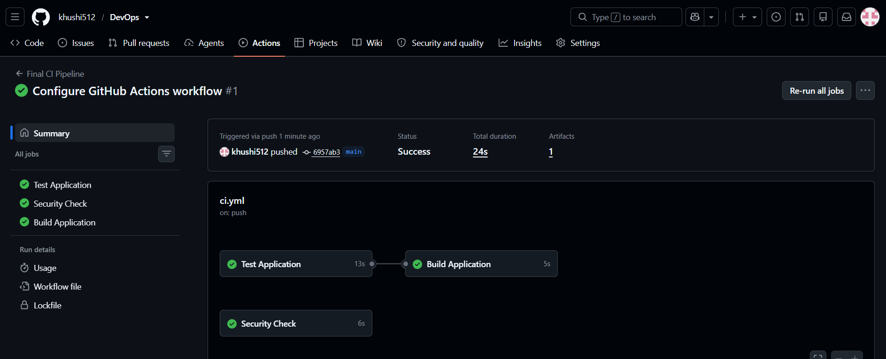
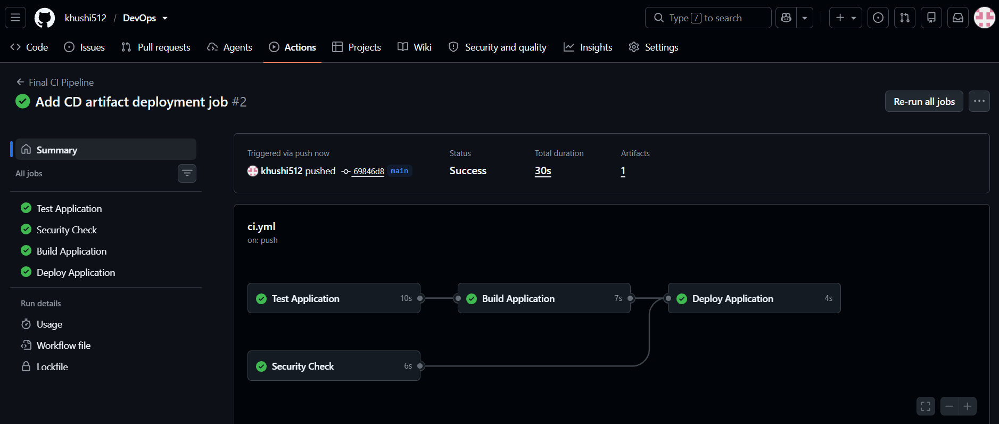

# Session 16: CI/CD with GitHub Actions

## Overview

This project demonstrates a CI/CD pipeline using GitHub Actions for a Python calculator application. The pipeline automatically tests the application, checks for common sensitive files, builds the application artifact, and verifies its delivery through a deployment job.

## Technologies Used

- Python
- Pytest
- Docker
- Git and GitHub
- GitHub Actions
- YAML and Bash

## Project Structure

```text
CI_CD_GithubActions/
├── app/
│   └── calculator.py
├── tests/
│   └── test_calculator.py
├── screenshots/
│   ├── ci.png
│   └── cd.png
├── Dockerfile
├── build.sh
├── requirements.txt
├── .gitignore
└── README.md
```

The GitHub Actions workflow is located at the repository root in `.github/workflows/ci.yml`, as required by GitHub Actions.

## CI vs CD

**Continuous Integration (CI)** automatically validates code changes by installing dependencies, running tests, performing a basic security check, and generating a build artifact.

**Continuous Delivery/Deployment (CD)** takes the generated artifact and runs a delivery step that verifies the required application files are available.

## Pipeline Architecture

```text
Git Push
   |
   v
GitHub Actions
   |
   +---- Test Application
   |       |
   |       v
   |   Run pytest
   |
   +---- Security Check
   |       |
   |       v
   |   Check sensitive filenames
   |
   +---- Build Application
   |       |
   |       v
   |   Generate build/
   |       |
   |       v
   |   Upload Artifact
   |
   v
Deploy Application
   |
   v
Download and Verify Artifact
```

The build job depends on the test job. The deploy job runs only after the test, security-check, and build jobs succeed.

## GitHub Actions Concepts

- **Workflow:** The automated pipeline defined in `.github/workflows/ci.yml`.
- **Jobs:** Independent units of work: test, security-check, build, and deploy.
- **Steps:** Individual operations within each job, such as checking out code, installing dependencies, and running tests.
- **Runner:** GitHub-hosted `ubuntu-latest` virtual machines that execute jobs.
- **Secrets:** GitHub Actions can securely provide credentials through repository or environment secrets. This project does not require secrets because it uses no external deployment service.
- **Artifacts:** Files generated by a workflow and stored for later use. The build artifact is named `calculator-build`.

## Pipeline Stages

### 1. Test Application

The workflow checks out the repository, sets up Python, installs dependencies from `requirements.txt`, and runs the automated tests using pytest.

The tests cover addition, subtraction, multiplication, division, and division by zero.

### 2. Security Check

The security job checks for files named `.env` and files with `.pem` or `.key` extensions. If matching files are found, the job fails.

This is a basic classroom demonstration and is not a comprehensive security scanner.

### 3. Build Application

The build job runs `build.sh`, which creates the `build/` directory containing:

```text
build/
├── calculator.py
└── build-info.txt
```

The workflow uploads these files as the `calculator-build` artifact.

### 4. Deploy Application

The deploy job downloads `calculator-build`, verifies that the expected files exist, and reports successful delivery.

This is a demonstration deployment executed on a temporary GitHub-hosted runner. It does not publish a persistent public application.

## Docker

The `Dockerfile` packages the calculator application using a Python base image. It can be built and run locally when Docker can access the required base image:

```powershell
docker build -t session16-calculator .
docker run --rm session16-calculator
```

## Run Locally

Install the dependencies:

```powershell
python -m pip install -r requirements.txt
```

Run the application:

```powershell
python app\calculator.py
```

Run the tests:

```powershell
python -m pytest -v
```

Run the build script in a Bash-compatible environment:

```bash
bash build.sh
```

## Pipeline Execution

The workflow triggers on pushes to `main`, pull requests targeting `main`, and manual execution through `workflow_dispatch`.

To inspect a run:

1. Open the GitHub repository.
2. Select **Actions**.
3. Open **Final CI Pipeline**.
4. Review the job results and build artifact.

## Screenshots

### CI Pipeline



### CD Pipeline



## Result

The project demonstrates automated testing, a basic security check, build artifact generation, artifact upload and download, and a delivery verification stage using GitHub Actions.

All stages can run using GitHub-hosted runners without requiring paid cloud infrastructure.
