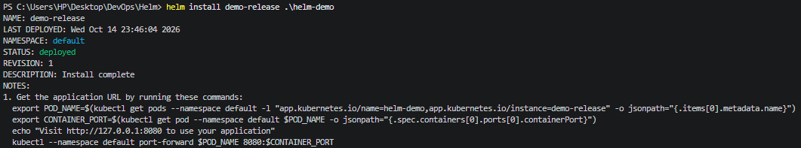
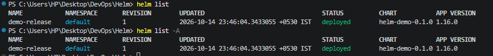
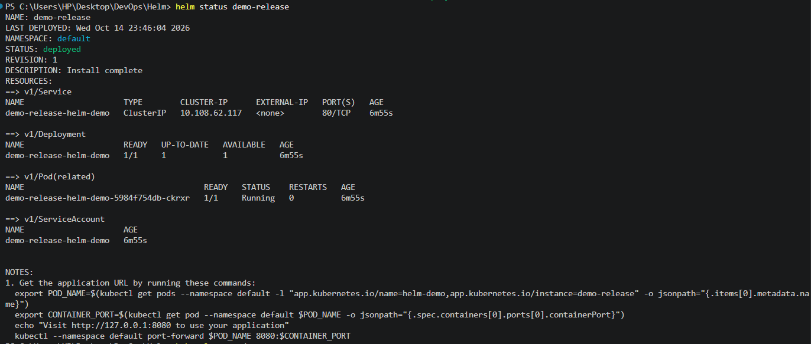
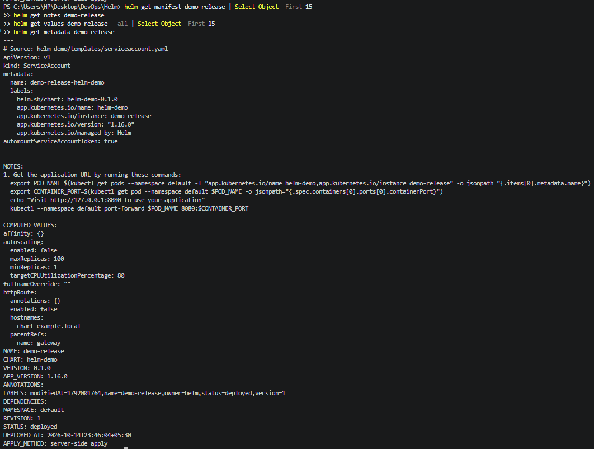
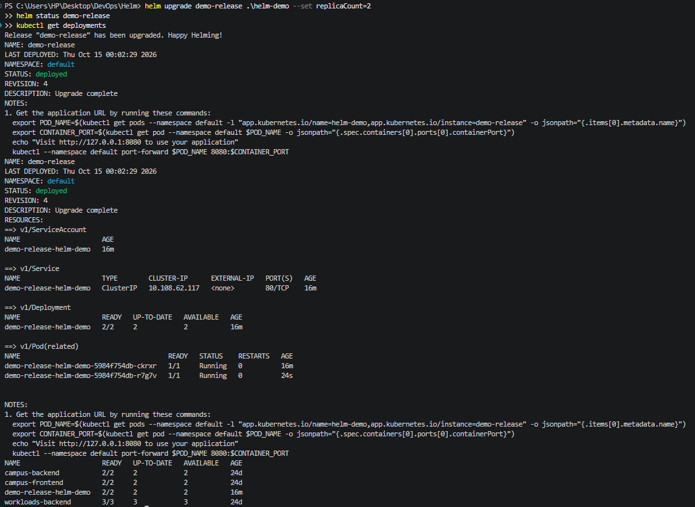
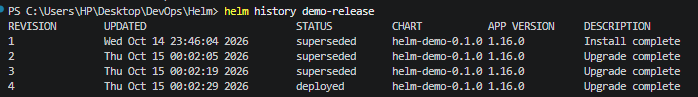
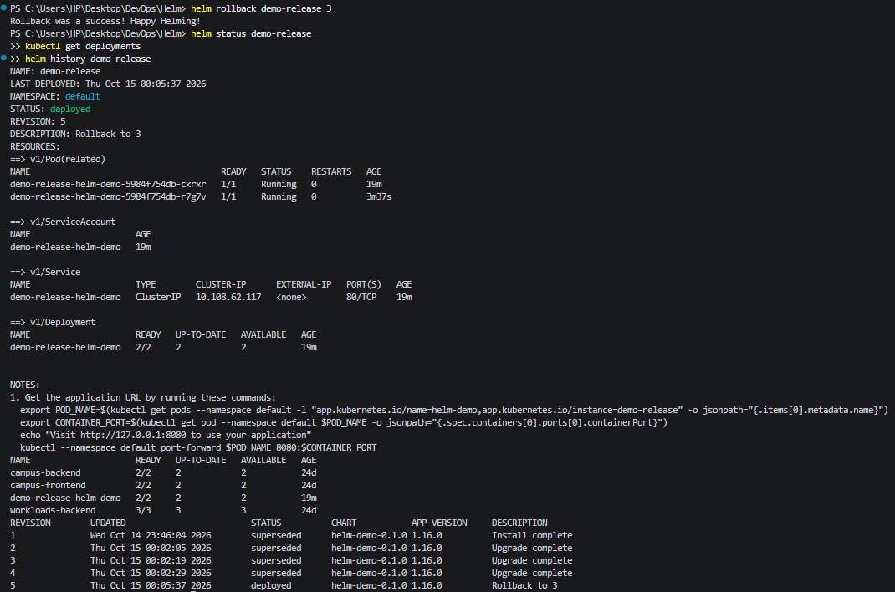
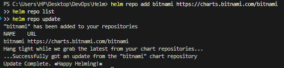
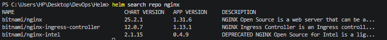
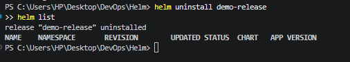

# Session 15: Helm

## Task 1: Helm Commands

### 1. `helm create`

**Command executed:**
```powershell
helm create helm-demo
```

**Purpose:** Creates a new Helm chart with a standard directory structure, including `Chart.yaml`, `values.yaml`, and Kubernetes resource templates.

**Files generated:** `Chart.yaml`, `values.yaml`, `templates/`, and `charts/`, along with other starter files.

**Observation:** The command generates a reusable chart scaffold that can be customized and deployed to Kubernetes.

**Screenshot:** 


### 2. `helm install`

**Commands executed:**
```powershell
helm lint .\helm-demo
helm install demo-release .\helm-demo
helm list
helm status demo-release
kubectl get deployments
kubectl get pods
kubectl get services
```

**Purpose:** Validates the chart and installs it as a release named `demo-release` in the current Kubernetes namespace.

**Observation:** Helm creates the Kubernetes resources defined by the chart templates and records the release so that it can be inspected, upgraded, or rolled back later.

**Verification:** Confirm the release is listed as `deployed`, and inspect the deployment, pods, and service.

**Screenshot:** 



### 3. `helm list`

**Commands executed:**
```powershell
helm list
helm list -A
```

**Purpose:** Lists Helm releases in the current namespace. The `-A` flag lists releases across all namespaces.

**Observed output:** The release `demo-release` appeared in the `default` namespace with status `deployed`, revision `1`, and chart `helm-demo-0.1.0`.

**Screenshot:** 



### 4. `helm status`

**Command executed:**
```powershell
helm status demo-release
```

**Purpose:** Displays detailed information about a Helm release, including its namespace, deployment status, revision, description, Kubernetes resources, and application access instructions.

**Observed output:**
- Release: `demo-release`
- Namespace: `default`
- Status: `deployed`
- Revision: `1`
- Deployment: `1/1` available
- Pod: `1/1 Running`
- Service: `ClusterIP`, port `80`

**Observation:** The release was successfully deployed, and its pod became healthy after the initial container startup.

**Screenshot:** 



### 5. `helm get`

**Commands executed:**
```powershell
helm get manifest demo-release
helm get notes demo-release
helm get values demo-release
helm get values demo-release --all
helm get metadata demo-release
```

**Purpose:** Retrieves information stored for an installed release.

- `helm get manifest`: Shows the rendered Kubernetes resources.
- `helm get notes`: Displays release usage instructions.
- `helm get values`: Shows user-supplied configuration values.
- `helm get values --all`: Shows user-supplied values together with chart defaults.
- `helm get metadata`: Displays release metadata supported by Helm 4.

**Observation:** These commands help inspect the installed configuration and resources without reinstalling the chart.

**Screenshot:** 



### 6. `helm upgrade`

**Command executed:**
```powershell
helm upgrade demo-release .\helm-demo --set replicaCount=2
helm status demo-release
kubectl get deployments
```

**Purpose:** Updates an existing Helm release using the specified chart and configuration values.

**Observation:** The release was upgraded successfully. The revision became `4`, and the deployment scaled from one replica to two, with both replicas ready.

**Screenshot:**



### 7. `helm history`

**Command executed:**
```powershell
helm history demo-release
```

**Purpose:** Displays the revision history of a Helm release, including revision number, update time, status, chart version, and description.

**Observation:** Four revisions were recorded. Revision 4 is currently deployed, while revisions 1–3 are superseded.

**Screenshot:** 



### 8. `helm rollback`

**Command executed:**
```powershell
helm rollback demo-release 3
helm status demo-release
kubectl get deployments
helm history demo-release
```

**Purpose:** Restores a Helm release to a previously recorded revision.

**Observation:** The rollback from revision 4 to revision 3 succeeded. Helm created revision 5 with the description Rollback to 3. The release status is deployed, and both replicas are running.

**Screenshot:** 



### 9. `helm repo`

**Commands executed:**
```powershell
helm repo add bitnami https://charts.bitnami.com/bitnami
helm repo list
helm repo update
```

**Purpose:** Manages Helm chart repositories. `add` registers a repository, `list` displays configured repositories, and `update` refreshes local chart information.

**Observation:** The repository was added and its chart index updated successfully.

**Screenshot:** 



### 10. `helm search`

**Commands executed:**
```powershell
helm search repo nginx
helm search repo
```

**Purpose:** Searches chart repositories for available Helm charts. The search term filters results by chart name and description.

**Observation:** The command displays matching charts, their chart versions, application versions, and descriptions.

**Screenshot:** 



### 11. `helm uninstall`

**Commands executed:**
```powershell
helm uninstall demo-release
helm list
```

**Purpose:** Removes an installed Helm release and its managed Kubernetes resources.

**Observation:** The release was uninstalled, and `helm list` no longer displayed `demo-release`.

**Screenshot:** 



