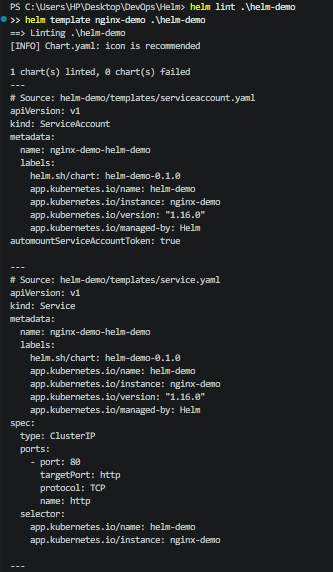
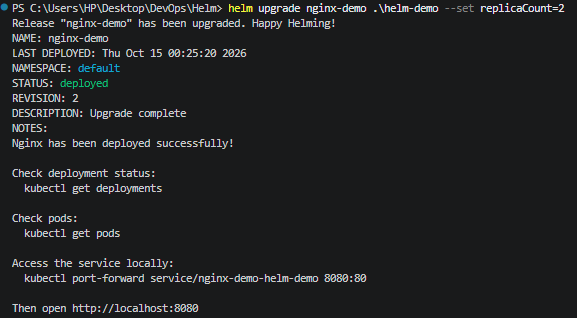
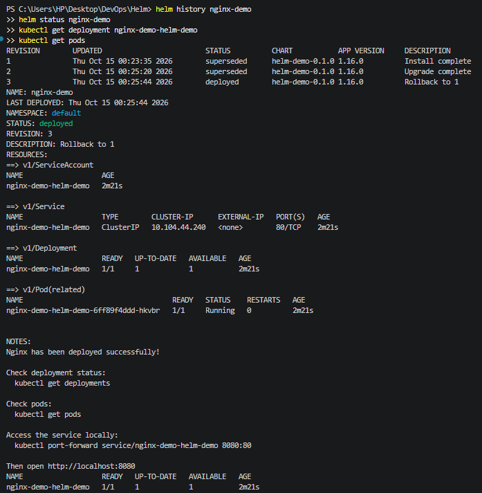

# Configurable Nginx Deployment Using Helm

## Overview
Created a reusable Helm chart to deploy Nginx on Kubernetes. The chart uses configurable values for replica count, container image, service configuration, and resource requests and limits.

## Technologies
- Kubernetes with Minikube
- Helm
- Nginx
- YAML

## Project Structure
- `Chart.yaml` — chart metadata and version
- `values.yaml` — default deployment configuration
- `templates/deployment.yaml` — Kubernetes Deployment with health probes and resource limits
- `templates/service.yaml` — ClusterIP Service
- `templates/serviceaccount.yaml` — ServiceAccount configuration
- `templates/NOTES.txt` — post-install instructions

## Validation
Validated the chart using `helm lint` and inspected its rendered Kubernetes resources using `helm template`.

### Screenshot:



## Deployment and Testing
```powershell
helm install nginx-demo .\helm-demo
helm status nginx-demo
kubectl get deployments
kubectl get pods
kubectl get services
```

## Upgrade and Rollback
Scaled the deployment from one replica to two using:

```powershell
helm upgrade nginx-demo .\helm-demo --set replicaCount=2
helm history nginx-demo
```
### Screenshot:



Rolled back to revision 1:

```powershell
helm rollback nginx-demo 1
helm history nginx-demo
kubectl get deployment nginx-demo-helm-demo
```

### Screenshot: 



## Final Result
- Helm release status: `deployed`
- Final revision: `3` — rollback to revision 1
- Final deployment readiness: `1/1`
- Nginx pod status: `Running`
- Service type: `ClusterIP`
